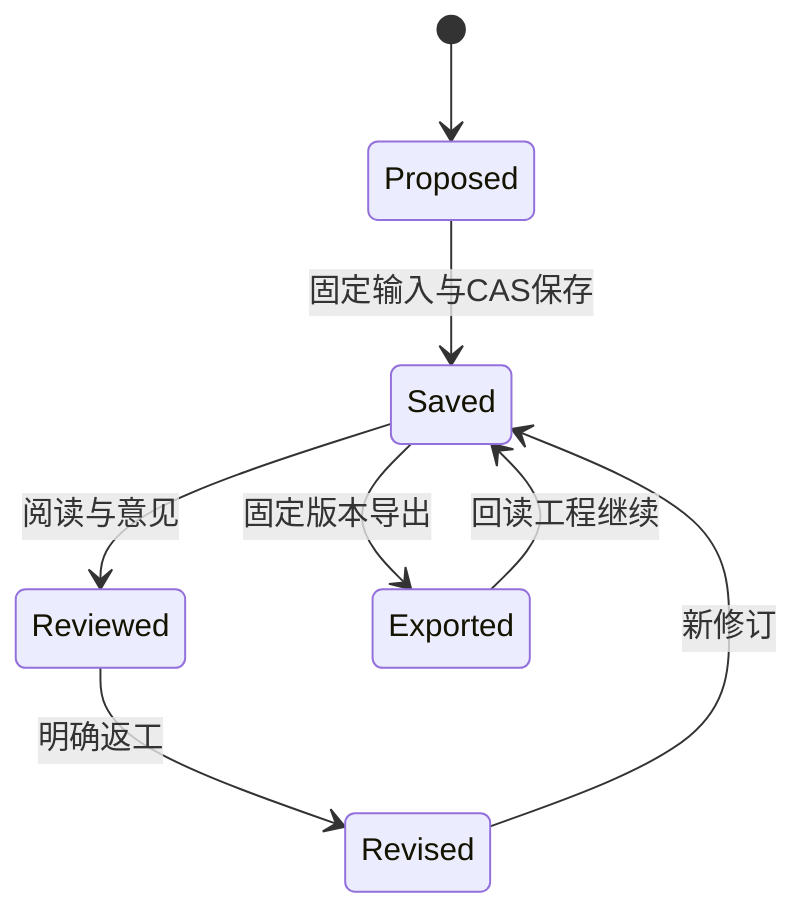

# 领域与本体设计

## 领域边界

正文与固定图像归宿主。本包维护最多32页的绘本专业工程；读取PNG/JPEG，图像合计8MiB、单图2MiB。导出RGB PDF与离线HTML，嵌入固定中文字体。毫米、出血、安全区与实际字体度量可验证；不承诺印厂认证、CMYK/PDF-X、儿童理解程度或生成质量。缺图、缺页、文字溢出及缺字阻止PDF交付。

| Owner | 拥有的事实 |
| --- | --- |
| 河图Core | WorkRef、固定来源、专业对象修订、CAS、原操作、正式正文及作者决定 |
| 本插件 | 专业结构、计算、专业偏好、视图与可再生成导出 |
| 外部Agent | 理解、规划、内容生成与方法执行 |
| 作者 | 取舍、采纳、定稿、内容外发和费用决定 |

## 核心本体

| 对象 | 存储集合 | 创作含义 |
| --- | --- | --- |
| page | pages | 绘本页 |
| note | notes | 页内意见 |

所有局部ID只在当前专业工程中有意义；同名、同ID或相同版本号不能跨作品推定身份。引用正文时固定UTF-8字节区间与原引文；引用媒体时固定宿主素材修订和摘要。

## 关系与不变量

project 1—N page；page 1—N image N—1 asset source；page 1—N text；note N—1 fixed page。

每个集合ID唯一，外键必须存在；删除仍被使用的对象拒绝保存。全对象更新与细粒度动作遵循同一校验，不存在绕过领域规则的编辑入口。来源更新先说明影响，再明确建立新修订。专业选中状态不扩大成宿主选用或作者定稿。

## 领域推断的证据边界

首封单页、偶数与奇数页跨页、左右阅读方向

毫米与点数换算、出血越界、文字安全区和真实度量溢出

PNG/JPEG摘要、低DPI、cover与contain、资源预算

中文缺字拒绝、嵌字PDF实际解析与页面栅格化

局部意见固定页摘要，修改文字或版式后旧意见变为stale

## 专业对象状态

此状态图描述工作旅程，不新增重复的数据库状态机。正文采纳与定稿由宿主另行处理。
