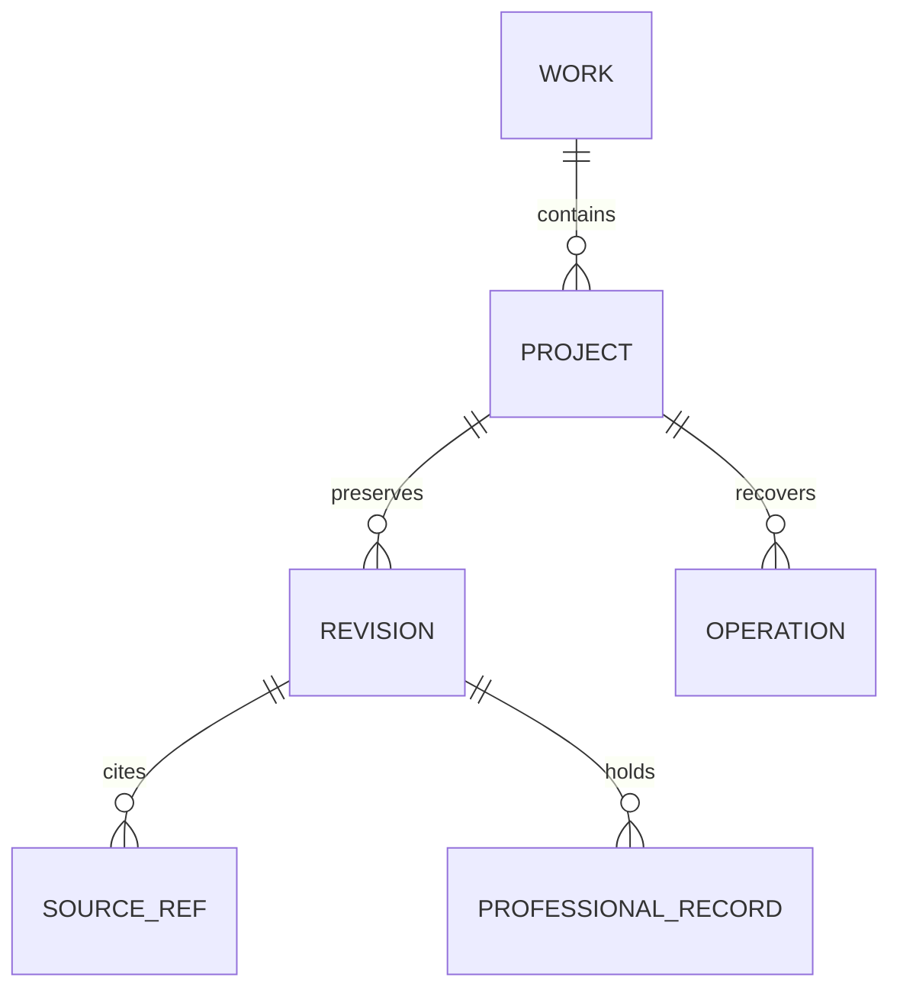
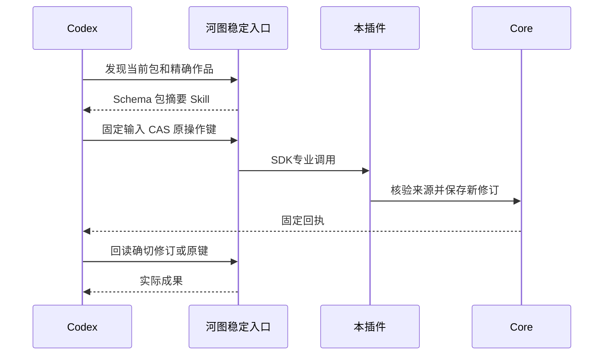

# 数据与API设计

## 数据格式

唯一可执行Schema是[包清单](../contracts/plugin-manifest.json)，`additionalProperties=false`拒绝拼错字段。`format_version=1`，Schema版本`1.0.0`；升级不得裁掉新字段覆盖旧数据。

| 根字段 | 类型 | 必填 |
| --- | --- | --- |
| format_version | constant | 是 |
| title | string | 是 |
| basis_refs | array | 是 |
| format | object | 是 |
| pages | array | 是 |
| notes | array | 是 |

### 绘本页 `pages`

| 字段 | 类型／范围 |
| --- | --- |
| id | `{"type":"string","maxLength":100,"minLength":1}` |
| number | `{"type":"integer","minimum":1,"maximum":32}` |
| title | `{"type":"string","maxLength":200,"minLength":1}` |
| turn_intent | `{"type":"string","maxLength":4000,"minLength":0}` |
| images | `{"type":"array","items":{"type":"object","additionalProperties":false,"properties":{"id":{"type":"string","maxLength":100,"minLength":1},"asset_source_index":{"type":"integer","minimum":0,"maximum":99},"alt":{"type":"string","maxLength":1000,"minLength":0},"rect":{"type":"object","additionalProperties":false,"properties":{"x":{"type":"number","minimum":-30,"maximum":1000},"y":{"type":"number","minimum":-30,"maximum":1000},"width":{"type":"number","minimum":0.1,"maximum":1000},"height":{"type":"number","minimum":0.1,"maximum":1000}},"required":["x","y","width","height"]},"fit":{"enum":["contain","cover"]}},"required":["id","asset_source_index","alt","rect","fit"]},"maxItems":8}` |
| texts | `{"type":"array","items":{"type":"object","additionalProperties":false,"properties":{"id":{"type":"string","maxLength":100,"minLength":1},"text":{"type":"string","maxLength":8000,"minLength":1},"rect":{"type":"object","additionalProperties":false,"properties":{"x":{"type":"number","minimum":-30,"maximum":1000},"y":{"type":"number","minimum":-30,"maximum":1000},"width":{"type":"number","minimum":0.1,"maximum":1000},"height":{"type":"number","minimum":0.1,"maximum":1000}},"required":["x","y","width","height"]},"font_size_pt":{"type":"number","minimum":8,"maximum":72},"line_height":{"type":"number","minimum":1,"maximum":2.5},"color":{"type":"string","pattern":"^#[0-9a-fA-F]{6}$"}},"required":["id","text","rect","font_size_pt","line_height","color"]},"maxItems":16}` |

### 页内意见 `notes`

| 字段 | 类型／范围 |
| --- | --- |
| id | `{"type":"string","maxLength":100,"minLength":1}` |
| page_id | `{"type":"string","maxLength":100,"minLength":1}` |
| page_sha256 | `{"type":"string","pattern":"^[a-f0-9]{64}$"}` |
| comment | `{"type":"string","maxLength":8000,"minLength":1}` |
| status | `{"enum":["open","resolved"]}` |
| resolution | `{"type":"string","maxLength":4000,"minLength":0}` |

## 数据库与持久化

本包不新增SQLite或第二个作品数据库。使用公开SDK的ProjectStore保存`picturebook`专业对象。宿主保存不可变修订，插件只提交内容和固定来源。

| 逻辑记录 | 主键／关系 | 维护Owner |
| --- | --- | --- |
| 专业对象 | WorkRef＋Owner＋object_id | Core |
| 专业修订 | object_id＋revision，sha256，previous_sha256 | Core |
| 操作回执 | 工作区＋Owner＋operation_key | Core |
| 专业内容 | 上述根对象及集合局部ID | 本包 |
| 来源／专业依据 | 固定WorkRef、修订与摘要 | 原Owner |

## 公开API

Codex先调用河图实际能力发现，再用`hetu.plugins.capabilities`取得本包Schema和摘要，最终通过`hetu.plugins.invoke`调用。绑定精确WorkRef、management_ref、plugin_id、package_sha256及capabilities_sha256；不将路径或标题当身份。

| 动作 | 用途 | 效果 |
| --- | --- | --- |
| list_projects | 查找专业工程 | read |
| get_project | 读取固定专业工程 | read |
| save_project | 保存专业工程 | managed_write |
| put_page | 维护绘本页 | managed_write |
| remove_page | 移除绘本页 | managed_write |
| put_note | 维护页内意见 | managed_write |
| remove_note | 移除页内意见 | managed_write |
| check_layout | 检查页序、文字排版与图像分辨率 | read |
| render_book | 读取离线绘本 | read |
| export_pdf | 导出固定嵌字绘本PDF | read |
| page_digest | 读取页内意见基线 | read |
| locate_page | 定位固定页与图像来源 | read |
| get_source | 读取固定来源 | read |
| get_basis | 读取固定专业依据 | read |
| compare_versions | 比较固定修订 | read |
| export_project | 导出固定专业报告 | read |
| build_context | 准备有界创作上下文 | read |
| create_handoff | 准备精确AI交接 | read |
| get_operation | 回读原操作 | read |

逐字段参数归清单，生成的[功能清单](../CAPABILITIES.md)和[方法操作地图](../skills/hetu-picturebook/references/operations.md)提供导航。

## 写入与错误

新建使用expected_revision=0和空expected_sha256；更新使用回读的确切修订和摘要，所有写入携带原operation_key。同键同输入回读原成果，同键不同输入拒绝；冲突保留输入。错误包括invalid_input、revision_conflict、idempotency_conflict、not_found和hetu.budget_exceeded，以实际宿主回执为准。

导出按固定对象分块，核对offset、总长度、分块与完整SHA-256。UTF-8分块不能切断字符，二进制不经字符串转码。

## 专业实现细则

每页的毫米矩形以裁切成品左上角为原点；负坐标只用于出血。PDF页包含双边出血并设置TrimBox和BleedBox，文字字号使用点。图像先检验尺寸后解码，图像层在文字层下。contain保留完整图像，cover居中裁切。DPI按实际缩放计算。HTML采用本机字体，不能代替嵌字PDF的精确排版。
