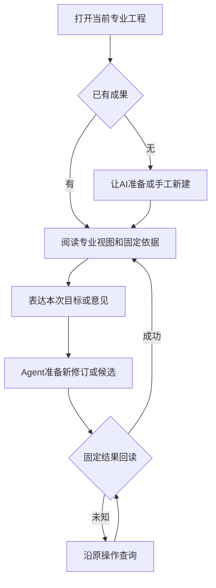

# 工作面与交互设计

## 工作面原则

独立工作面，左上角“返回作品”，宿主顶部和左侧不重复包围插件。页头紧凑，当前工程和修订明确，主要操作是“让AI处理”。高级JSON编辑只作补充，不能替代专业阅读、计算、参考板或媒体播放。

## 视图组织

- 跨页阅读：按对应专业结构阅读，缺少资料时显示具体下一步。
- 图文与翻页：按对应专业结构阅读，缺少资料时显示具体下一步。
- 版面检查：按对应专业结构阅读，缺少资料时显示具体下一步。
- 局部意见：按对应专业结构阅读，缺少资料时显示具体下一步。
- 接续创作：按对应专业结构阅读，缺少资料时显示具体下一步。

## 视觉及可访问性

复用河图Radix色板、静止柔和渐变与半透明表面；正文和输入保持实色。字号12／14／20px，细边框0.5px；无装饰动画。主题、减少透明度与高对比分别仿真；宽窗与窄窗保持完整语义和键盘可达。

## 交互状态

加载保持结构，空状态不虚构内容，失败就地说明；未知写入显示原键回读。刷新不覆盖未保存稿，冲突保持本次输入，显式比较和重建基线后才保存。关闭重开恢复缓冲，停用阻止新调用并保留旧成果。

## 专业验收重点

首封单页、偶数与奇数页跨页、左右阅读方向; 毫米与点数换算、出血越界、文字安全区和真实度量溢出; PNG/JPEG摘要、低DPI、cover与contain、资源预算; 中文缺字拒绝、嵌字PDF实际解析与页面栅格化; 局部意见固定页摘要，修改文字或版式后旧意见变为stale。完整实际渲染和尺寸断言见08，不以页面能加载作为完成。
