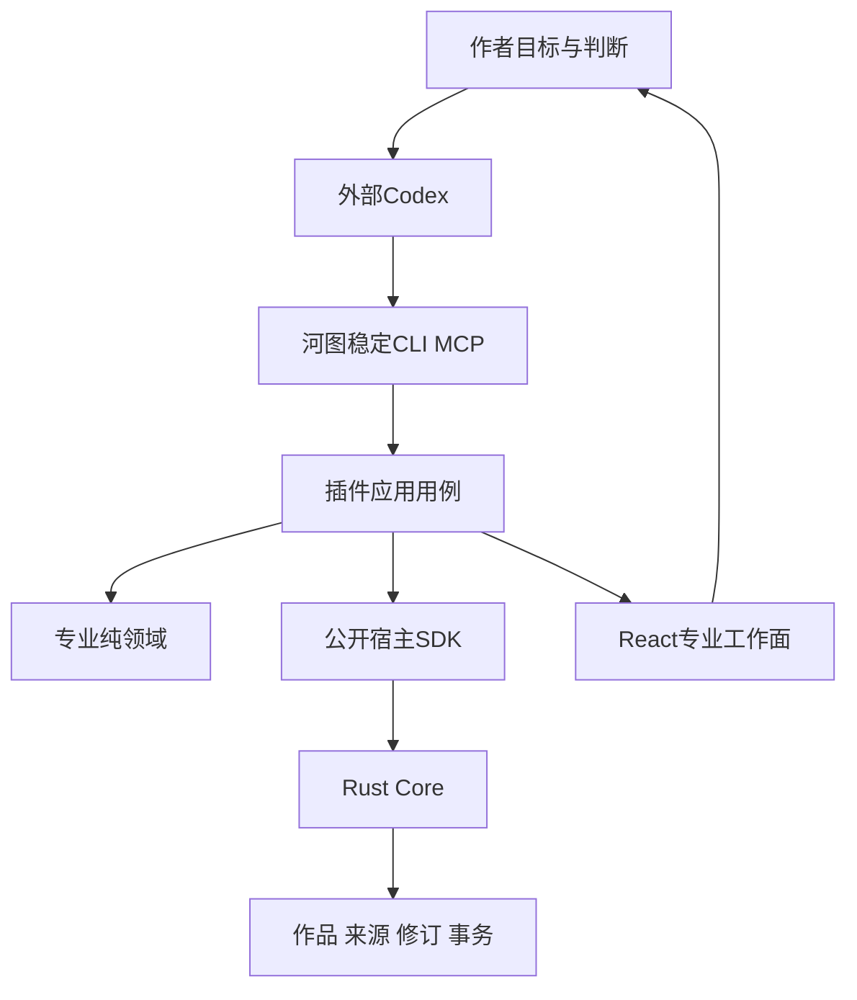

# 架构与技术选型

## 架构原则

宿主保持精炼稳定：作品、固定来源、候选、意见、作者决定及确定性事务归Core；本插件持有绘本工坊专业结构与算法。领域不依赖Electron、数据库、工具供应商或视图，应用层只依赖公开SDK，视图不直写Core文件。

## 技术选型

| 层 | 选择 | 原因 |
| --- | --- | --- |
| 领域 | TypeScript纯函数 | 可直接测试专业正反例，避免协议与算法缠绕 |
| 输入合同 | JSON Schema Draft-07、Ajv预编译 | 字段闭合、运行与机器发现一致 |
| 应用 | 公开SDK、ProjectStore | 复用固定引用、CAS和原键恢复 |
| 工作面 | React18、共享Radix语义样式 | 按专业内容渲染，跨系统共享Web层 |
| 构建 | 固定esbuild及TypeScript | 独立运行包、源码与许可可追踪 |
| 分发 | GitHub固定发行＋河图目录 | 包与宿主解耦，逐版本兼容验收 |

Cordis生命周期由宿主负责，本包使用apply／effect／invoke协议，不重新实现调度框架。相同JS/TS技术栈不表示原DSH包直接兼容。

## 专业取舍

正文与固定图像归宿主。本包维护最多32页的绘本专业工程；读取PNG/JPEG，图像合计8MiB、单图2MiB。导出RGB PDF与离线HTML，嵌入固定中文字体。毫米、出血、安全区与实际字体度量可验证；不承诺印厂认证、CMYK/PDF-X、儿童理解程度或生成质量。缺图、缺页、文字溢出及缺字阻止PDF交付。

有限输入和预算优先于无界推演；确定性检查报告缺失前提，不伪装语义理解。无第二套作品权限、正文库、模型连接或内部生成循环。

## 风险与验收

格式损失、虚构前提、来源不足、并发修改和平台差异分别取证。实际机器、界面及发行归08；作者认可不能由算法通过代替。
